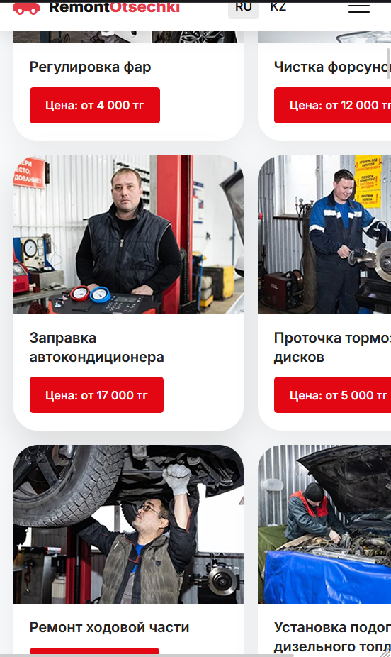
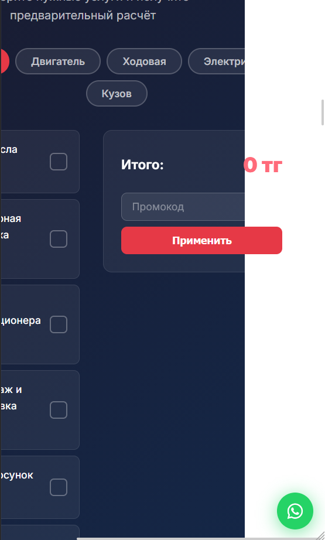
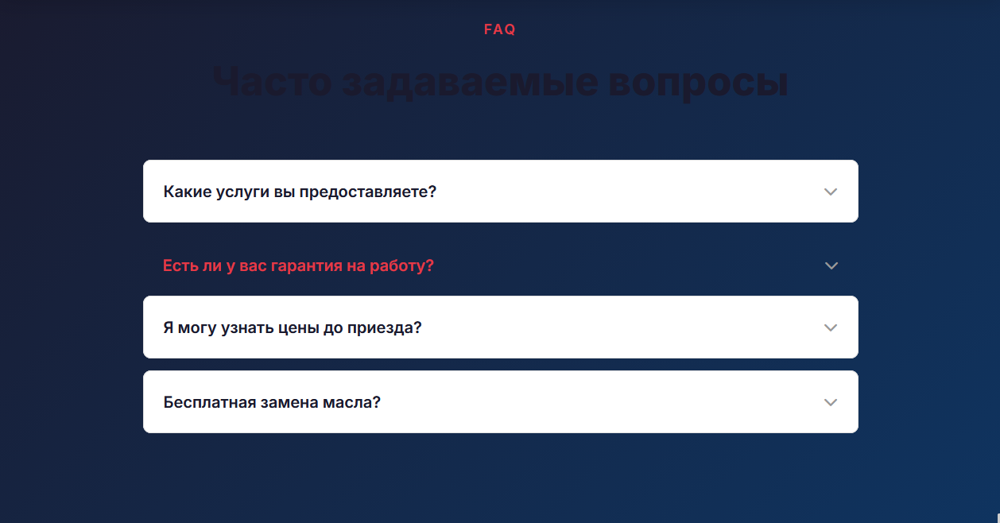
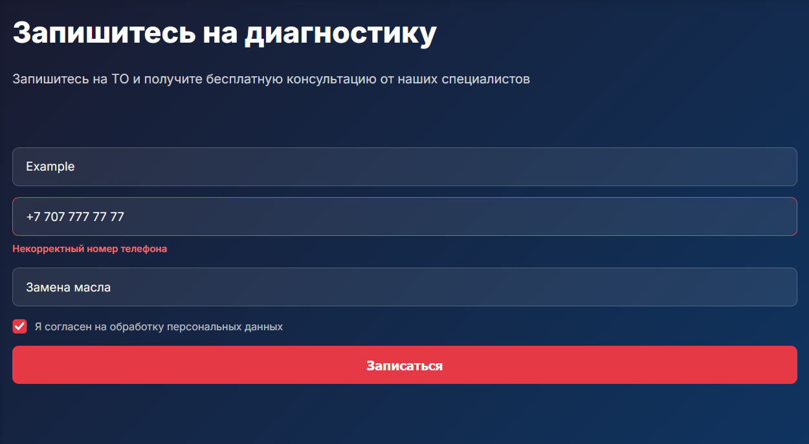

# Remont_do_otsechki — отчёт об ошибках и их исправлении

Лендинг автосервиса в Алматы: фронтенд на React (`app.jsx`, `styles.css`, `translations.js`) и бэкенд на Node.js + Express + SQLite (`server.js`) для приёма заявок на ТО.

Запуск:

```bash
npm install
npm start          # http://localhost:3000, админка — /admin
```

При тестировании сайта нашли 6 ошибок: 2 в вёрстке под мобильные устройства и 4 в логике интерфейса. Ниже по каждой: где находится, как проявляется, как воспроизвести, в чём причина и как исправили.

## Сводная таблица

| № | Ошибка | Файл | Тип | Серьёзность |
|---|--------|------|-----|-------------|
| 1 | На телефоне страница шире экрана, появляется горизонтальная прокрутка | `styles.css` | Адаптивная вёрстка | Высокая |
| 2 | На телефоне не открывается меню (бургер) | `app.jsx` | Не срабатывает кнопка | Высокая |
| 3 | Кнопка «Записаться на ТО» на главном экране ничего не делает | `app.jsx` | Не срабатывает кнопка | Высокая |
| 4 | Калькулятор показывает неправильную сумму | `app.jsx` | Логика | Высокая |
| 5 | Вопросы в FAQ не раскрываются | `app.jsx` | Не срабатывает элемент | Средняя |
| 6 | Форма записи отклоняет правильный номер телефона | `app.jsx` | Валидация | Высокая |

---

## Ошибка 1. Кривая вёрстка на мобильном телефоне

**Где:** `styles.css`, блок `@media (max-width: 480px)`.

**Как проявляется:**
- карточки услуг не помещаются по ширине и вылезают за правый край экрана;
- страницу можно прокручивать вбок, рядом с контентом видна пустая полоса;
- четыре счётчика на главном экране («14+ лет опыта» и др.) стоят в одну строку, цифры и подписи наезжают друг на друга.

**Скриншоты (iPhone SE, 375 px):**

| Карточки услуг вылезают за край | Справа пустая белая полоса, калькулятор обрезан | Счётчики сжаты в 4 колонки |
|---|---|---|
|  |  |  |

**Как воспроизвести:**
1. Откройте сайт в Chrome, нажмите F12 и включите режим устройства (Ctrl+Shift+M).
2. Выберите iPhone SE (375 px) или Galaxy S8 (360 px).
3. Прокрутите до раздела «Услуги автосервиса» и попробуйте сдвинуть страницу вбок.

**Причина:** для телефонов сетке услуг задали две колонки фиксированной ширины по 260 px. Вместе с отступом это ~536 px, а экран телефона — 360–414 px. Счётчикам задали 4 колонки вместо 2. Кроме того, удалили правило `overflow-x: hidden`, которое не давало странице прокручиваться вбок.

**Было (с ошибкой):**
```css
@media (max-width: 480px) {
    .container { padding: 0 16px; }
    .hero-stats { grid-template-columns: repeat(4, 1fr); gap: 12px; padding: 16px; }
    ...
    .services-grid { grid-template-columns: repeat(2, 260px); }
}
```

**Стало (исправлено):**
```css
@media (max-width: 480px) {
    body { overflow-x: hidden; }
    .container { padding: 0 16px; }
    .hero-stats { grid-template-columns: 1fr 1fr; gap: 12px; padding: 16px; }
    ...
    .services-grid { grid-template-columns: 1fr; }
}
```

**Найденные при проверке исходные проблемы адаптива (тоже исправлены):**
- **Калькулятор на телефоне вылезал за экран.** Базовые стили `.calc-layout { grid-template-columns: 1fr 1fr }` и `.calc-summary { position: sticky }` стояли в `styles.css` *после* медиа-запросов и перекрывали мобильные правила. Все медиа-запросы перенесены в конец файла.
- **Шапка на планшетах (769–1024 px)** не вмещала 7 пунктов меню, переключатель языка и кнопку. Бургер-меню теперь включается с 1024 px, а кнопка «Записаться» в шапке скрывается с 600 px.
- **Заголовок FAQ** был тёмным на тёмном фоне и почти не читался. Теперь он белый.
- **Сетки** с `minmax(300px, 1fr)` переведены на `minmax(min(300px, 100%), 1fr)`, чтобы на узких экранах колонка не была шире контейнера.
- **Длинные значения** в реквизитах и контактах переносятся (`overflow-wrap: anywhere`).
- **Слайдер брендов** пересчитывает ширину карточек при повороте телефона.
- **Поля ввода** на телефоне имеют шрифт 16 px, чтобы iOS не увеличивал страницу при фокусе.
- **Заголовки разделов** при переходе по меню больше не прячутся под шапкой (`scroll-margin-top`).
- **У списка «Выберите услугу»** появилась стрелка.

Проверено в браузере на ширине 320, 360, 375, 414, 480, 540, 600, 768, 820, 900, 1024, 1280 и 1440 px: ни один элемент не выходит за границы экрана.

**Вывод:** в адаптивной вёрстке не используем фиксированные размеры в пикселях для колонок. Используем `1fr`, `%` или `minmax()`. Проверяем страницу на ширине 360 px.

---

## Ошибка 2. На телефоне не открывается меню

**Где:** `app.jsx`, компонент `Header`, кнопка `.burger`.

**Как проявляется:** на экране уже 768 px вместо меню показывается кнопка-«бургер» (три полоски). Нажатие на неё ничего не делает: меню не открывается, иконка не превращается в крестик. Перейти к разделам сайта с телефона через меню невозможно.

**Как воспроизвести:**
1. Включите режим устройства в DevTools (ширина < 768 px).
2. Нажмите на три полоски в правом верхнем углу.

**Причина:** обработчик нажатия записывает в состояние его текущее значение, а не противоположное. Состояние `open` всегда остаётся `false`.

**Было:**
```jsx
<button className={`burger ${open ? 'active' : ''}`} ... onClick={() => setOpen(open)}>
```

**Стало:**
```jsx
<button className={`burger ${open ? 'active' : ''}`} ... onClick={() => setOpen(prev => !prev)}>
```

Дополнительно: пока меню открыто, страница под ним не прокручивается (класс `menu-open` на `body`). Меню закрывается клавишей Esc и при расширении окна.

**Вывод:** у переключателя (toggle) новое значение должно быть противоположно текущему: `!open`. Ещё надёжнее функциональная форма `setOpen(prev => !prev)`.

---

## Ошибка 3. Кнопка «Записаться на ТО» на главном экране не срабатывает

**Где:** `app.jsx`, компонент `Hero`, первая кнопка в блоке `.hero-buttons`.

**Как проявляется:** нажатие на большую красную кнопку «Записаться на ТО» на первом экране ничего не делает: страница не прокручивается к форме записи. Ошибок в консоли нет. Такая же кнопка в шапке сайта работает.

**Скриншот:** при наведении на кнопку в строке состояния браузера видна правильная ссылка `#appointment`, но нажатие не прокручивает страницу к форме.


**Как воспроизвести:**
1. Откройте главную страницу.
2. Нажмите «Записаться на ТО» под заголовком «СТО в Алматы».

**Причина:** в `querySelector` указан id `#appointment-form`, а у секции с формой id `appointment`. Элемент не находится, `querySelector` возвращает `null`, и оператор `?.` молча пропускает вызов `scrollIntoView`. Переход по ссылке тоже не происходит, потому что `e.preventDefault()` отменяет стандартное действие ссылки.

**Было:**
```jsx
onClick={(e) => { e.preventDefault(); document.querySelector('#appointment-form')?.scrollIntoView({ behavior: 'smooth' }); }}
```

**Стало:**
```jsx
onClick={(e) => { e.preventDefault(); document.querySelector('#appointment')?.scrollIntoView({ behavior: 'smooth' }); }}
```

**Вывод:** оператор `?.` скрывает ошибку, если элемент не найден. Id, которые используются в нескольких местах, лучше хранить в константе, чтобы опечатка не расходилась с разметкой.

---

## Ошибка 4. Калькулятор показывает неправильную сумму

**Где:** `app.jsx`, компонент `PriceCalculator`, расчёт `total`.

**Как проявляется:** вместо суммы показывается огромное число. Например, при выборе «Замена масла» (4 000 ₸) и «Компьютерная диагностика» (4 000 ₸) итог равен **4 000 400 000 000 000 000 000 ₸** вместо **8 000 ₸**.

**Скриншот:**


**Как воспроизвести:**
1. Прокрутите до раздела «Калькулятор стоимости».
2. Отметьте две любые услуги.
3. Посмотрите на «Итого».

**Причина:** у `reduce` начальное значение — пустая строка `''`, а не число `0`. Поэтому `+` склеивает значения как строки, а не складывает их. Склеиваются не только выбранные цены, но и `0` за каждую невыбранную услугу: `'' + 4000 + 4000 + 0 + 0 + … = '4000400000000…'`. Затем строка превращается в число при вычитании скидки и выводится как огромная сумма.

**Было:**
```jsx
const total = filtered.reduce((sum, s) => sum + (selected[s.id] ? s.price : 0), '');
```

**Стало:**
```jsx
// Сумма считается по всем выбранным услугам, а не только по видимым в текущей категории
const total = t.calcServices.reduce((sum, s) => sum + (selected[s.id] ? s.price : 0), 0);
```

Попутно исправлена ещё одна ошибка: раньше сумма считалась только по услугам открытой категории (`filtered`). Если выбрать «Замену масла» и переключиться на «Ходовую», она пропадала из итога.

**Вывод:** у `reduce` всегда задаём начальное значение нужного типа. Расчёт суммы проверяем минимум на двух выбранных позициях.

---

## Ошибка 5. Вопросы в FAQ не раскрываются

**Где:** `app.jsx`, компонент `FAQ`.

**Как проявляется:** при нажатии на вопрос в разделе «Часто задаваемые вопросы» ответ не появляется, стрелка не поворачивается. Вдобавок нажатый вопрос теряет белую карточку и выглядит как красный текст на тёмном фоне.

**Скриншот:** нажат вопрос «Есть ли у вас гарантия на работу?». Ответ не раскрылся, стиль карточки пропал.



**Как воспроизвести:**
1. Прокрутите до раздела FAQ.
2. Нажмите на любой вопрос.
3. В DevTools (вкладка Elements) у элемента появляется класс `faq-itemactive`.

**Причина:** при добавлении класса пропущен пробел. Вместо двух классов `faq-item active` получается один несуществующий `faq-itemactive`. Правило `.faq-item.active .faq-answer`, которое показывает ответ, к нему не применяется. Обычные стили `.faq-item` (белый фон, рамка) тоже перестают действовать, поэтому карточка пропадает. Состояние React меняется правильно, сломано только имя класса.

**Было:**
```jsx
<div className={'faq-item' + (active === i ? 'active' : '')} key={i}>
```

**Стало:**
```jsx
<div className={'faq-item' + (active === i ? ' active' : '')} key={i}>
```

**Вывод:** имена классов удобнее собирать через шаблонную строку `` `faq-item ${active === i ? 'active' : ''}` `` или библиотеку `classnames`. Тогда пробел не потеряется.

---

## Ошибка 6. Форма записи отклоняет правильный номер телефона

**Где:** `app.jsx`, компонент `AppointmentForm`, функция `validate`.

**Как проявляется:** при вводе номера в обычном виде, например `+7 707 777 77 77` или `8 (707) 777-77-77`, форма показывает ошибку «Некорректный номер телефона» и не отправляет заявку. Номер принимается только без пробелов, скобок и дефисов (`+77077777777`), хотя пользователи обычно пишут не так. Автосервис теряет заявки.

**Скриншот:** все поля заполнены, согласие отмечено, но номер `+7 707 777 77 77` отклонён.



**Как воспроизвести:**
1. Перейдите к форме «Записаться на ТО».
2. Введите имя и телефон `+7 707 777 77 77`, отметьте согласие.
3. Нажмите «Отправить».

**Причина:** из регулярного выражения удалили допустимые символы-разделители (пробел, дефис, скобки). К тому же правила проверки на клиенте и на сервере (`server.js`) стали разными.

**Было:**
```jsx
else if (!/^[\+]?[0-9]{7,15}$/.test(phone.trim())) e.phone = t.formErrors.phoneInvalid;
```

**Стало** (то же правило теперь и на сервере в `server.js`):
```jsx
else if (!/^[\+]?[0-9\s\-\(\)]{7,20}$/.test(phone.trim()) || phone.replace(/\D/g, '').length < 7) e.phone = t.formErrors.phoneInvalid;
```

Лимит увеличен с 15 до 20 символов: номер `8 (707) 777-77-77` занимает 17 символов и раньше отклонялся. Дополнительная проверка требует минимум 7 цифр, чтобы не проходили строки вроде `(--- ---)`.

**Вывод:** клиент и сервер проверяют данные по одному правилу. Тестируем валидацию на номерах в разных форматах, в которых их вводят реальные пользователи.

---

## Как проверяли исправления

| № | Проверка после исправления | Результат |
|---|----------------------------|-----------|
| 1 | iPhone SE / Galaxy S8 в DevTools: страница не прокручивается вбок, карточки в одну колонку, счётчики 2×2 | ✅ |
| 2 | Нажатие на бургер открывает меню, повторное нажатие или выбор пункта закрывает | ✅ |
| 3 | Кнопка на главном экране плавно прокручивает страницу к форме записи | ✅ |
| 4 | 4 000 + 8 000 = 12 000 ₸; промокод даёт скидку 10 % от верной суммы | ✅ |
| 5 | Вопрос раскрывается и закрывается, стрелка поворачивается | ✅ |
| 6 | Номер `+7 707 777 77 77` принимается, заявка появляется в `/admin` | ✅ |
